# Architecture

zenmqtt is an asyncio MQTT 5 client. This document describes how it is built:
the layers, the main objects, how packets and messages move, and why some
things are done the way they are.

## Layers

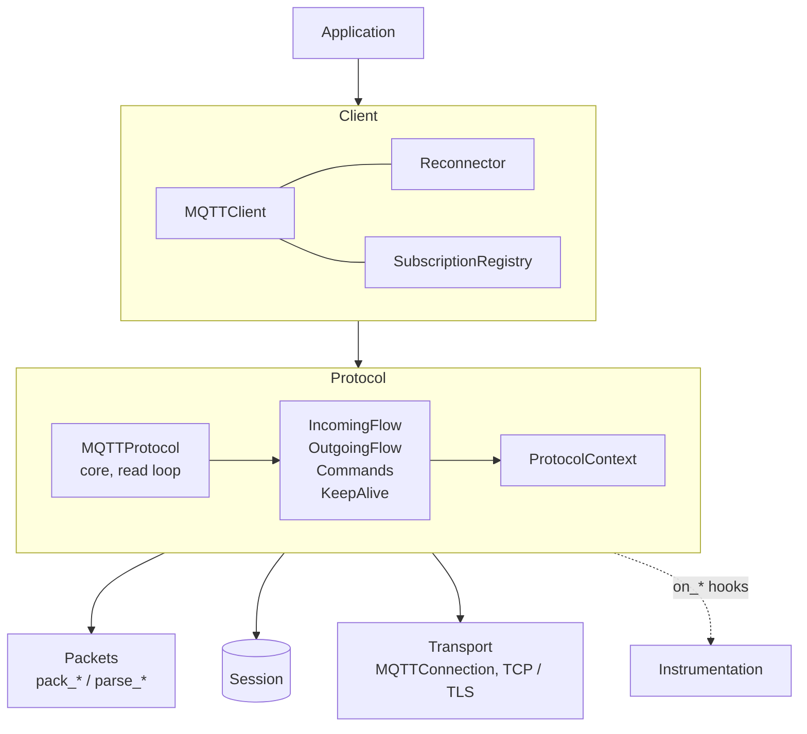

| Layer | Job | Knows about |
|---|---|---|
| Client | public API, reconnect, restoring subscriptions, one reader of messages | the protocol |
| Protocol | MQTT 5 flows: connect, publish in both directions, subscribe, keep alive | packets, session, transport |
| Packets | packing and parsing of bytes, no I/O | nothing else |
| Transport | bytes over TCP or TLS | nothing about MQTT |
| Session | storage of in-flight QoS 1/2 state | nothing about connections |
| Instrumentation | metrics hooks, monitors, OpenTelemetry adapter | nothing about the protocol |

Each layer only calls the layer below it. The protocol doesn't know about
reconnect, and the transport doesn't know about MQTT.

## Package layout

```text
zenmqtt/
  client.py             MQTTClient: the public API
  reconnector.py        Reconnector: reconnect loop with backoff
  reconnect.py          ReconnectPolicy, reason codes that stop reconnecting
  subscriptions.py      SubscriptionRegistry: subscriptions to restore
  session.py            MQTTSession, BaseSession, InMemorySession
  exceptions.py         all public exceptions
  connection/           transports: registry of URL schemes, TCP and TLS
  mqtt/                 packets: CONNECT, PUBLISH, SUBSCRIBE, properties, limits
  mqtt/protocol/        the protocol: core and its parts
  instrumentation/      MetricsCollector, Tracing, monitors, OpenTelemetry adapters
```

## Client

`MQTTClient` is a thin layer over `MQTTProtocol`. It adds what a long-running
service needs:

- **Reconnect.** After the first successful connect, a `Reconnector` task waits
  until the connection is lost and connects again with exponential backoff.
  It stops on reason codes which a retry can't fix (bad credentials, banned,
  session taken over, ...), or when the policy has no attempts left.
- **Waiting while reconnecting.** `publish()`, `subscribe()` and
  `unsubscribe()` wait until the client is connected again. Subscribe and
  unsubscribe are repeated if the connection was lost before the answer; a
  publish isn't repeated, because the session re-sends it.
- **Restoring subscriptions.** `SubscriptionRegistry` keeps the subscriptions
  which the server accepted. If the server reports that the session isn't
  present, they are subscribed again.
- **One reader.** `client.messages` may be read by one task. A second task
  which waits for a message at the same time gets `RuntimeError`.
- **Without reconnect** (`reconnect=None`), a small task waits until the
  connection is lost and calls `protocol.close()`. Pending publish calls fail
  with `ConnectionLostError` and the iteration over messages ends.
- **Graceful shutdown.** `disconnect(timeout=...)` rejects new operations and
  waits until the server acknowledged the outgoing QoS 1/2 messages in flight,
  then sends DISCONNECT. See [Graceful shutdown](#graceful-shutdown).

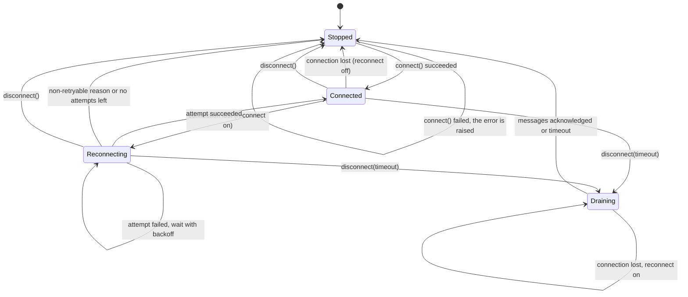

When the client stops after it was connected, it calls `protocol.close(exc)`:
waiting publish calls fail and the message iteration ends.

## Protocol

`MQTTProtocol` (`mqtt/protocol/core.py`) owns one connection at a time and
the read loop. The work is split into four parts:

| Part | Job |
|---|---|
| `IncomingFlow` | incoming PUBLISH, the message buffer, `ack()` in the order of receiving, QoS 2 receiver states, topic aliases of the server |
| `OutgoingFlow` | `publish()`, the send quota ("Receive Maximum" of the server), re-sending from the session after reconnect |
| `Commands` | SUBSCRIBE / UNSUBSCRIBE and their answers |
| `KeepAlive` | PINGREQ when the client is idle, closes the connection if PINGRESP doesn't come |

The parts share a `ProtocolContext`: the current connection, the
`connected` flag, the server limits from CONNACK and the metrics. Only the core
changes the connection, `connected` and the limits. For the parts they are
read-only properties, and mypy rejects an assignment.

### State across a lost connection

The protocol doesn't end anything when the connection is lost:

- QoS 1/2 publish calls keep waiting. The message is in the session and is
  re-sent on the next connect; the call gets the answer to the re-sent packet.
- `next_message()` keeps waiting for messages of the next connection.
- SUBSCRIBE and UNSUBSCRIBE calls fail with `ConnectionLostError`, because
  they aren't stored.

The owner (the client) calls `close(exc)` when nothing will connect anymore.
This way the protocol has one behaviour, and the decision "reconnect or stop"
is only in the client.

### Read loop

`set_connection()` starts one read loop task per connection. `PacketReader`
reads the socket in chunks of 64 KiB and returns whole packets; all complete
packets in the buffer are returned before the next read. Each packet goes to
a handler from a table by packet type.

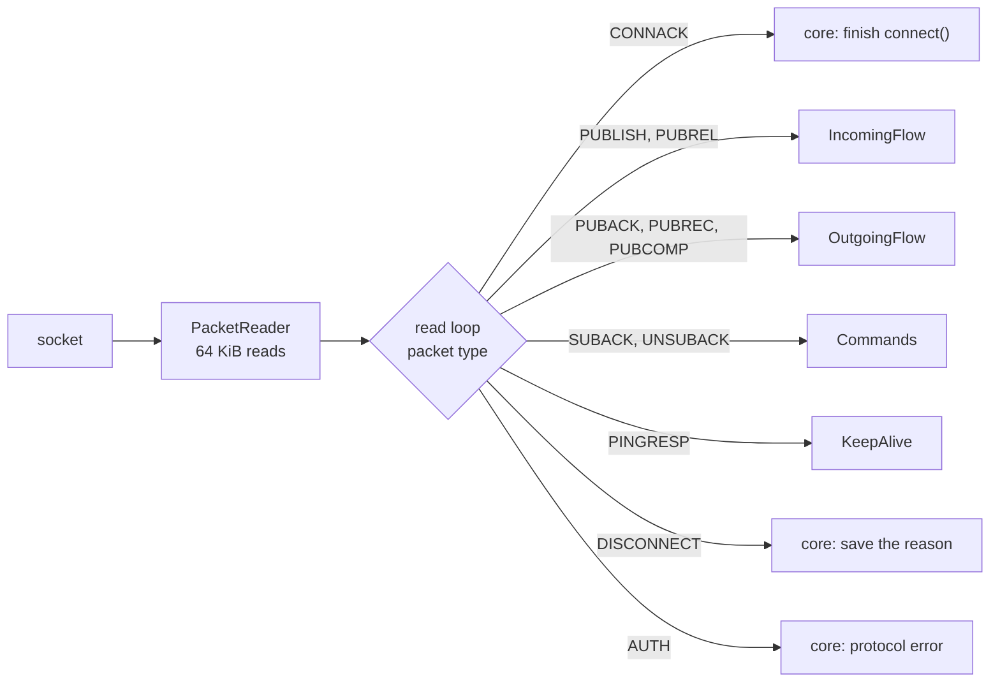

The read loop never waits for the application. Incoming messages go to a
buffer, so acknowledgements, PINGRESP and other control packets are handled
even when the application is slow.

Errors in the read loop close the connection:

| Error | What the client does |
|---|---|
| `ProtocolError` and its subclasses (malformed packet, invalid topic alias, too many QoS 1/2 messages, packet too large) | sends DISCONNECT with the reason code of the error, closes the connection |
| packet type 0 | DISCONNECT 0x81 Malformed Packet |
| a packet only a client sends (CONNECT, PINGREQ, ...) | DISCONNECT 0x82 Protocol Error |
| AUTH | DISCONNECT 0x82 if CONNECT had no authentication method, 0x83 otherwise (enhanced authentication isn't supported) |
| any other exception in a handler, e.g. the session storage failed | DISCONNECT 0x83 Implementation specific error |
| an error of the socket | closes the connection |

After a handler error the state of the flow is unknown, so the connection is
closed. After reconnect, the session and the server re-send what isn't
completed.

### Connect

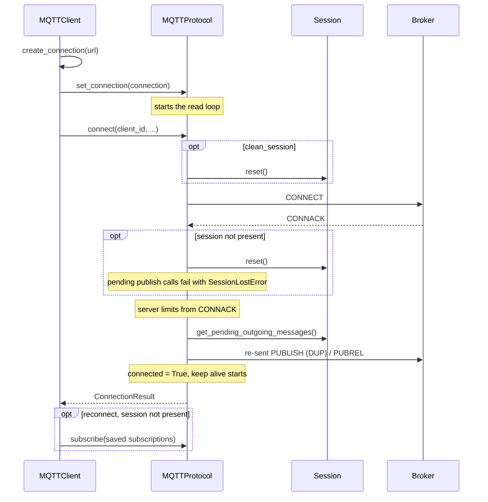

## Incoming messages

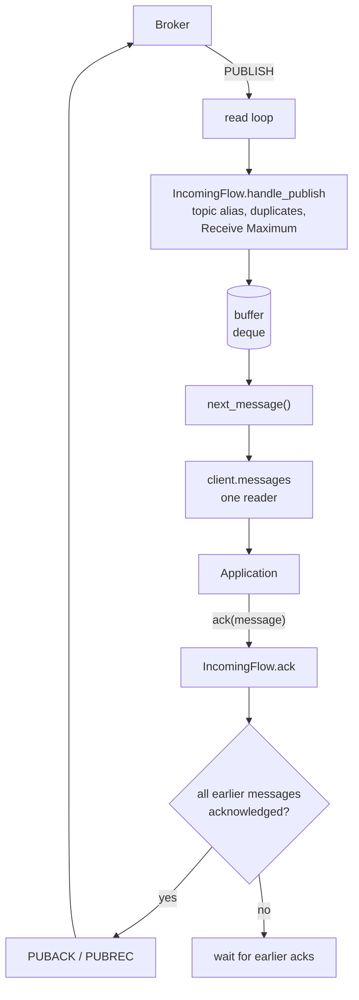

- **Acknowledgement after processing.** Every QoS 1/2 message must be
  acknowledged by `client.ack()`. MQTT 5 (section 4.6) requires
  acknowledgements in the order of receiving, so one message which isn't
  acknowledged holds back the acks of all later messages.
  `AckBlockedMonitor` logs a warning when this lasts 30 seconds.
- **Flow control.** QoS 1/2 messages which aren't acknowledged count to
  "Receive Maximum" which the client sends in CONNECT. When it's reached, the
  server stops sending QoS 1/2 messages. A server which sends more breaks the
  protocol (DISCONNECT 0x93).
- **QoS 0 isn't limited.** If the application is slower than the server, QoS 0
  messages grow the buffer. `BufferMonitor` logs a warning and reports the
  buffer size to metrics from 1000 waiting messages; the client doesn't drop
  messages.
- **Duplicates.** A QoS 1/2 message which the server sends again before it's
  acknowledged isn't delivered again; the ack of the first copy answers both
  (MQTT 5, section 4.3.3).
- **Lost connection.** Unread QoS 1/2 messages are removed from the buffer,
  because the server sends them again. Unread QoS 0 messages stay.

QoS 2 on the receiver side:

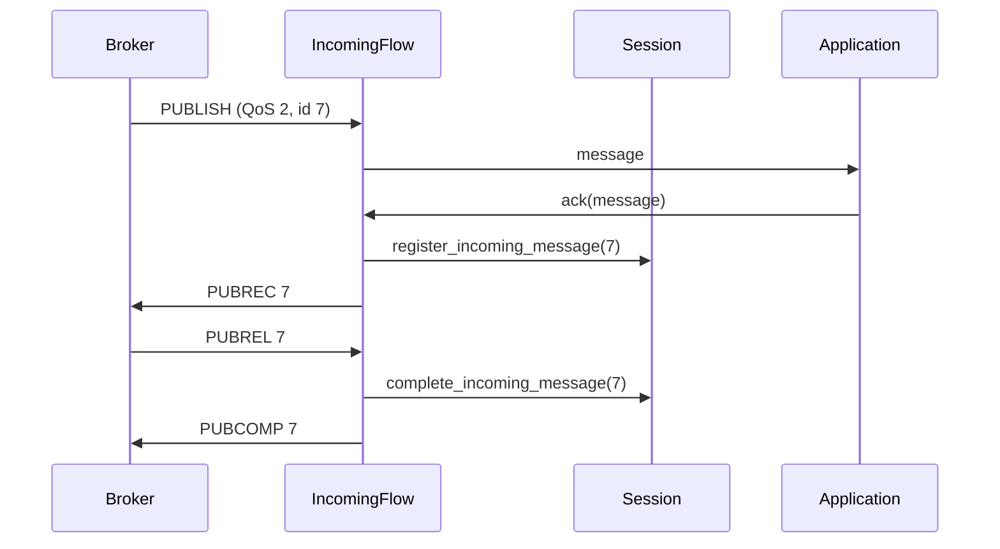

If the server sends PUBLISH 7 again after PUBREC, the session already has
id 7: the message isn't delivered again, and PUBREC is sent again.

## Outgoing messages

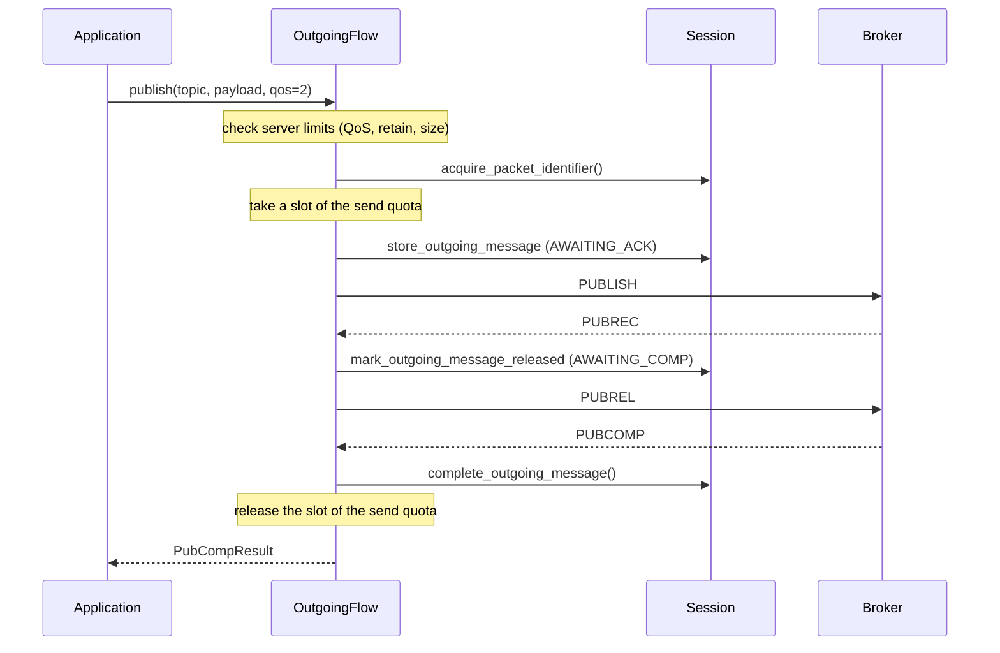

QoS 1 is the same up to PUBACK, which completes the message.

- **Limits first.** The limits of the server from CONNACK (maximum QoS, retain,
  maximum packet size, topic aliases) are checked before anything is stored
  or sent. A message which breaks a limit raises a `ServerLimitError`.
- **Send quota.** The number of QoS 1/2 messages without the final answer is
  limited by "Receive Maximum" of the server. Extra publish calls wait for a
  free slot.
- **Failure before sending.** If storing fails or the call is cancelled before
  the message is stored, the packet identifier and the quota slot are released.
- **After storing,** the message belongs to the session. A cancelled publish
  call doesn't cancel the delivery.
- **Re-send.** On every connect with a present session, the session's
  messages are sent again: PUBLISH with DUP for `AWAITING_ACK`, PUBREL for
  `AWAITING_COMP`. Topic aliases are removed, because they belong to one
  connection.
- **QoS 0** isn't stored: it's written to the socket and `publish()` returns.

Outgoing message states in the session:

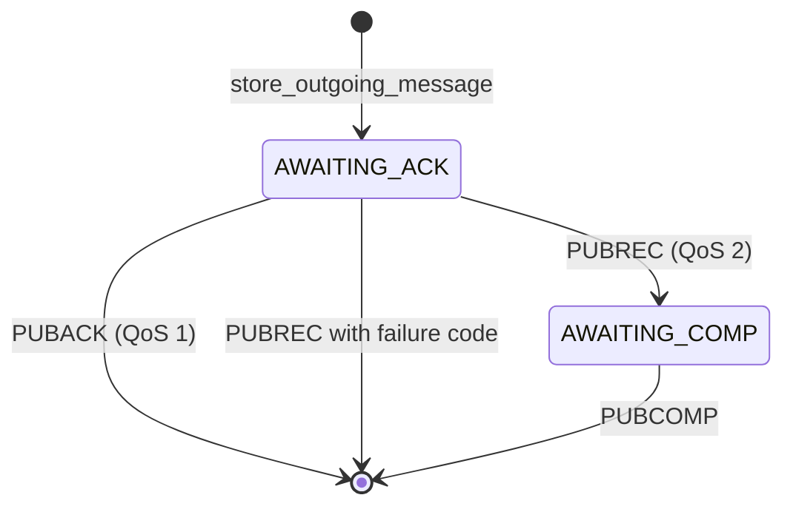

## Session

`MQTTSession` is the interface of the storage: packet identifiers, outgoing
messages with their state, and the ids of incoming QoS 2 messages between
PUBREC and PUBREL.

- `BaseSession` implements the logic. A storage implements a few methods:
  save, load and delete of outgoing messages and incoming ids, and clear.
- `InMemorySession` is the default.
- `examples/sqlite_session.py` stores the session in SQLite, so messages
  survive a restart of the application.

The session survives reconnects only if the server keeps its session too:
`clean_session=False` and `session_expiry_interval > 0` in the connect
properties. If CONNACK says that the session isn't present, the client
discards its own session.

## Graceful shutdown

`disconnect()` without a timeout sends DISCONNECT at once. Outgoing QoS 1/2
messages in flight stay in the session; with the in-memory session they are
lost when the process exits. `disconnect(timeout=...)` closes the client
without losing them, e.g. on SIGTERM:

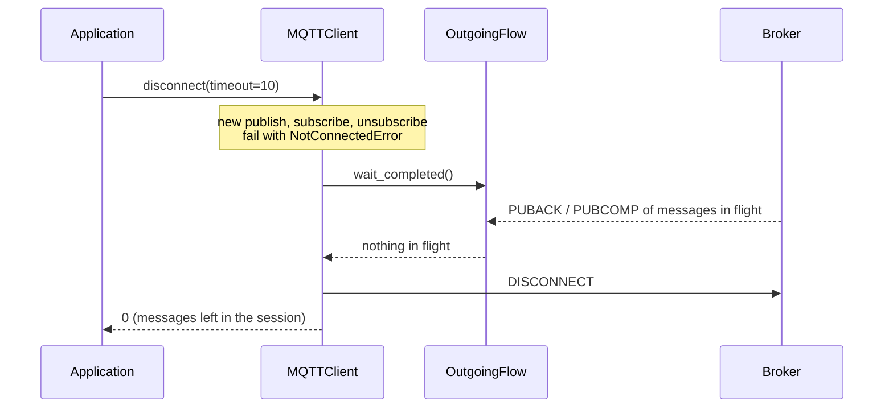

- "In flight" means: QoS 1/2 publish calls which haven't returned, and
  messages re-sent from the session after reconnect. `OutgoingFlow` counts the
  calls and wakes up the waiter when a message completes; the hot path only
  sets an event.
- QoS 0 messages are written to the socket at once, so there is nothing to
  wait for.
- With automatic reconnect, a lost connection doesn't end the wait: the client
  reconnects, the session re-sends the messages, and their acknowledgements
  are waited for until the timeout. Without reconnect, nothing will re-send
  them, so the wait ends when the connection is lost.
- `disconnect()` returns the number of outgoing QoS 1/2 messages which the
  server didn't acknowledge; they stay in the session. After a timeout a
  warning is logged.
- Incoming messages aren't waited for. Messages which the application didn't
  acknowledge are sent again by the server on the next connect with this
  session.

## Keep alive

`KeepAlive` sends PINGREQ when the client didn't write any packet during the
keep alive period. If PINGRESP doesn't come within the same period, the
connection is closed; with reconnect on, the client connects again. "Server Keep Alive" from
CONNACK replaces the value of the client. `client.ping()` shares the
PINGREQ in flight, because PINGRESP has no packet identifier.

## Transport

- `create_connection(url)` picks a transport by the URL scheme: `tcp://` and
  `mqtt://` (port 1883), `mqtts://` and `ssl://` (TLS, port 8883). Other
  schemes can be added with `register_implementation()`.
- `MQTTConnection` wraps a transport and remembers the time of the last
  write, for keep alive.
- **Backpressure on write.** The TCP transport waits for `drain()` after every
  write, so a fast publisher can't fill the memory when the broker reads
  slowly.

## Instrumentation

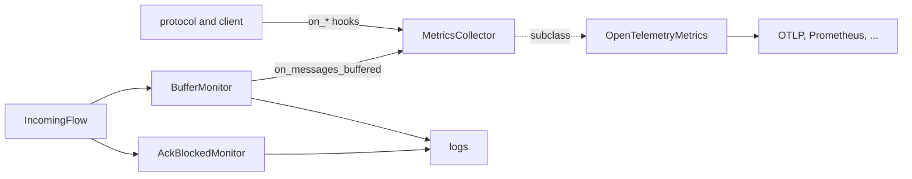

- `MetricsCollector` has one method per event: connect, packets sent and
  received, publish completed, message received, ping, reconnect attempts,
  buffered messages and more. All methods do nothing by default.
- **Instrumentation never changes the data path.** The client wraps the
  collector once: an exception in a hook is caught and logged (the first one
  with the traceback, then at most once a minute with the number of errors),
  so a broken metrics adapter can't close the connection or stop reconnect.
  Hooks which the collector doesn't override aren't wrapped and cost nothing.
  Tracing is wrapped the same way: a publish which the server acknowledged
  doesn't fail because its span couldn't be ended, and the tracing context
  around `processing()` never swallows an exception of the application.
- The protocol only calls these hooks where the event happens. The timestamps
  for durations are part of the flow state; for example, the latency of a
  re-sent message isn't counted from its first send.
- The monitors (`BufferMonitor`, `AckBlockedMonitor`) only observe: they log and
  report, they don't change the behaviour of the client.
- `OpenTelemetryMetrics` exports the events as OpenTelemetry metrics. Topics
  aren't attributes, because their number isn't limited.

### Tracing

Tracing is optional: `MQTTClient(tracing=...)` takes a `Tracing` object, and
`OpenTelemetryTracing` implements it. Without it, the client doesn't call any
tracing code and OpenTelemetry isn't imported.

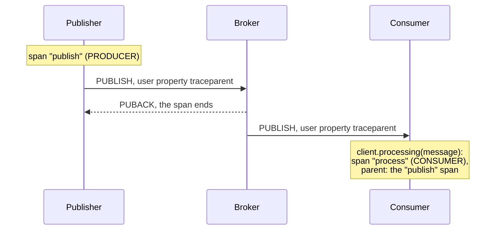

- **Publish:** the span starts when `publish()` is called, so it includes the
  waiting for a reconnect. It ends when the packet is written (QoS 0) or with
  the final acknowledgement (QoS 1/2). A failure reason code or an exception
  sets the error status.
- **Propagation:** the context of the publish span is injected into the user
  properties by the configured propagator (W3C `traceparent` by default). Keys
  of the propagator replace the same keys of the application; other user
  properties are kept. A re-sent message keeps the same properties, so it
  stays in the same trace.
- **Processing:** the application wraps the processing of a message in
  `client.processing(message)`. The span uses the context from the message as
  parent, or the current span if the message has no context. The span is
  explicit, so it can't leak for messages which are never acknowledged.
- **Span names** are `publish` and `process`, without the topic: the number of
  topics isn't limited. The topic is the attribute
  `messaging.destination.name`.

## Errors

| Exception | When |
|---|---|
| `NotConnectedError` | the client isn't connected and doesn't reconnect |
| `ConnectionLostError` | the connection was lost before the answer, without reconnect or after the client stopped |
| `SessionLostError` | the server didn't keep the session, the message was discarded |
| `ServerLimitError`: `QoSNotSupportedError`, `PacketTooLargeError`, `FeatureNotSupportedError` | the operation breaks a limit of the server from CONNACK; nothing is sent |
| `ProtocolError` and subclasses | the server broke the protocol; the client closes the connection with the matching reason code |
| `RuntimeError` | a second task reads `client.messages` at the same time |
| `ValueError` | invalid arguments, e.g. QoS 3 |

Invalid input which the server rejects anyway (for example a wildcard in a
publish topic) isn't validated by the client: the server closes the connection
with its reason code.

## Design decisions

- **The read loop never waits for the application.** Otherwise one slow
  message handler would stop PINGRESP and PUBACK handling, and the server
  would close the connection.
- **Acks only after processing, in the order of receiving.** A message is
  acknowledged when the application is done with it, so a crash doesn't lose
  it. The order is required by MQTT 5.
- **No memory limit for QoS 0.** Dropping messages silently is worse than
  using memory; a warning and a metric tell about a slow application.
- **One reader of messages.** Several readers make the end of messages and the
  ack order hard to reason about. To process messages concurrently, read them
  in one task and hand them to workers.
- **One behaviour of the protocol.** The protocol keeps its state across a lost
  connection; only the client decides whether to reconnect or stop.
- **Only standard library.** The OpenTelemetry adapter is an optional extra.
